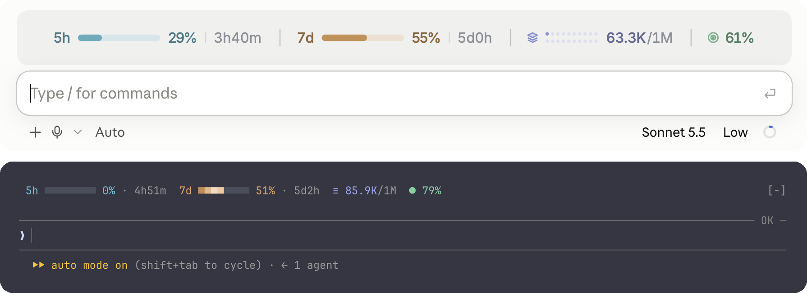
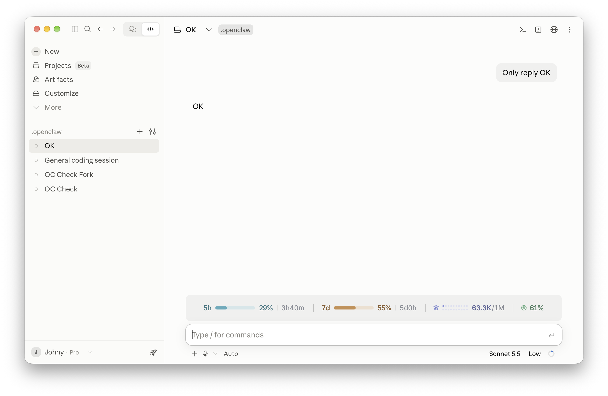
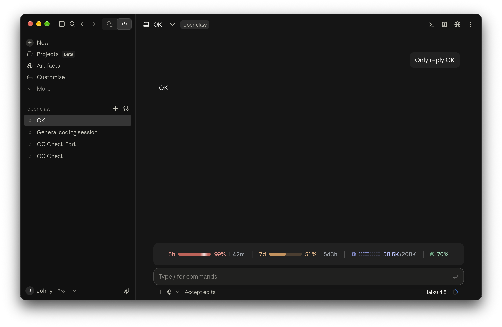
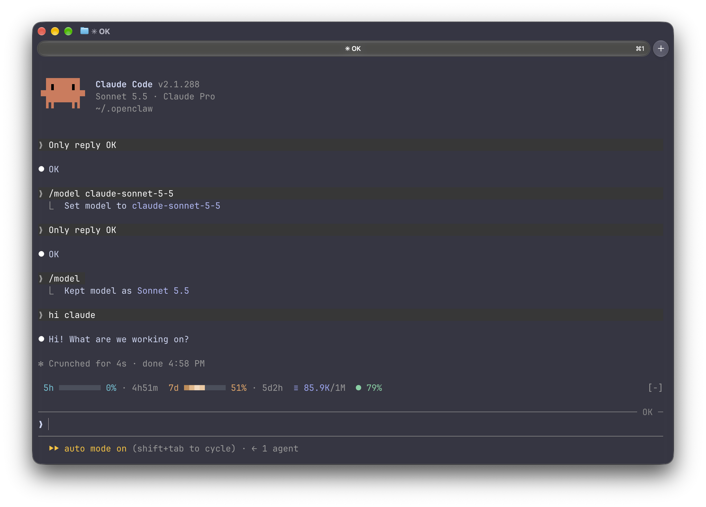

<div align="center">

# CC-Gauge

**额度、上下文、缓存命中率，在输入框上方一眼看清。**

[](./LICENSE)
[](https://claude.com/claude-code)
[](https://claude.com/blog/claude-code-mods)


[English](./README.md) · 简体中文



</div>

---

`cc-gauge` 是一个 [Claude Code 模组（mod）](https://claude.com/blog/claude-code-mods)。它在输入框上方显示一行状态，包含工作时最值得留意的四个数据。终端和桌面端各有一套专门的布局，每一轮对话结束后自动更新，平时安静地待着，只在需要注意时才变红提醒你。

> 本插件仿照 Jetson Chan 的 [CC-Usage-Band](https://github.com/JetsonChan/CC-Usage-Band)（MIT 许可证）改写，详见[来源](#来源)。

> **让 AI 助手帮你安装？** 让它运行[安装](#安装)里的两条命令即可。给 AI 助手的说明：安装成功后，用户只需要知道下面这段话：
>
> *cc-gauge 已安装。新开一个会话（或输入 `/reload-plugins`），输入框上方就会显示 5h 和 7d 额度、上下文窗口和缓存命中率。不需要任何配置。*

## 目录

- [功能](#功能)
- [使用要求](#使用要求)
- [安装](#安装)
- [设置](#设置)
- [数据说明](#数据说明)
- [终端兼容性](#终端兼容性)
- [隐私与权限](#隐私与权限)
- [开发](#开发)
- [截图](#截图)
- [来源](#来源)
- [许可证](#许可证)

## 功能

| 指标 | 显示内容 |
| --- | --- |
| **5h** 额度 | 5 小时滚动额度已用了多少，以及还有多久重置 |
| **7d** 额度 | 7 天额度的用量和重置时间 |
| **上下文窗口**（图层图标） | 当前上下文占用的 token 数和模型窗口大小，例如 `398K/1M` |
| **缓存命中率**（靶心图标） | 上一轮输入中有多少由提示缓存提供 |

- **一眼看清**：每项数据都有自己的颜色。只有在需要注意时才会变红：额度或上下文超过 80%，或者缓存命中率低于 50%。
- **有动感但不打扰**：额度进度条上有一道缓慢的扫光，所有进度条同步移动。
- **两端原生适配**：
  - 终端里是一行字符，图标可以用 Nerd Font 或普通 Unicode 字符，并且会根据窗口宽度自动调整显示的内容。
  - 桌面端是一行铺满宽度、两端对齐的 SVG 图形，额度用进度条显示，上下文用 2×10 的点阵灯显示，并且支持浅色和深色模式。
- **和其他插件共存**：别的插件也可以在输入框上方画内容（比如 [CC-Doc-Review](https://github.com/sapronlee/cc-doc-review)）。不管谁先加载，它们的内容都排在本插件上面，不会被挡住。
- **轻量**：不读文件、不运行程序、不联网，只读取 Claude Code 本来就有的用量数据。

## 使用要求

- Claude Code **2.1.287 或更新版本**（模组功能是从这个版本开始提供的），终端和桌面端的 Code 页都可以用。
- 5h 和 7d 额度只有订阅账号才有数据。没有订阅时，这一行只显示上下文和缓存命中率。
- **推荐搭配 [Ghostty](https://ghostty.org) 终端使用。** Ghostty 自带这一行用到的图标字体，不用做任何设置就能看到完整效果。其他终端也能用，图标会简单一些。

## 安装

在 Claude Code 里输入这两条命令：

```
/plugin marketplace add sapronlee/claude-plugins
/plugin install cc-gauge@sapronlee
```

然后**新开一个会话**，输入框上方就会出现这一行。就这么简单，不需要任何配置。

- 想在当前会话里马上看到？输入 `/reload-plugins`。
- 5h 和 7d 额度要等会话里 Claude 第一次回复后才会显示。

如果只想在一个会话里临时试用，可以从本地克隆后加载：

```bash
git clone https://github.com/sapronlee/cc-gauge.git
claude --plugin-dir cc-gauge
```

**更新**

```
/plugin marketplace update sapronlee
```

**卸载**

```
/plugin uninstall cc-gauge@sapronlee
```

## 设置

不需要任何设置。终端里的图标会自动选择：在 Ghostty 里用 Nerd Font 图标，在其他终端里用普通 Unicode 字符。桌面端的图标是自己画的。

如果终端里的图标显示成方框，或者你在别的终端里也装了 Nerd Font，可以在 shell 配置文件（比如 `~/.zshrc`）里加一行，然后新开一个会话：

```bash
export CC_GAUGE_ICONS=unicode   # auto（默认）· nerd · unicode · ascii
```

## 数据说明

| 指标 | 数据来源 | 说明 |
| --- | --- | --- |
| 5h / 7d | Claude Code 从每次 API 响应中读到的额度窗口 | 四舍五入到整数百分比，重置倒计时每分钟更新一次。 |
| 上下文 | 最后一次请求的输入总量：未缓存部分 + 缓存读取 + 缓存写入 | 按当前模型的窗口大小计算，1M 和 200K 的模型都能正确显示。桌面端每个点代表窗口的 5%，先点亮上排，再点亮下排。 |
| 缓存命中率 | 上一轮的 `缓存读取 / (未缓存输入 + 缓存读取 + 缓存写入)` | 把这一轮里所有请求加总后计算，不包括子代理的轮次。 |

## 终端兼容性

| 终端 | `auto` 下的图标 | 颜色 |
| --- | --- | --- |
| Ghostty | Nerd Font（自带） | 真彩色 |
| iTerm2、WezTerm、kitty、Warp | Unicode（`≡` `●`） | 真彩色 |
| macOS 自带终端 | Unicode | 256 色，自动换算 |
| 其他终端 | Unicode | 按终端支持的颜色显示 |

如果图标显示成方框，设置 `CC_GAUGE_ICONS=unicode` 就行（见[设置](#设置)）。可以运行 `/cc-gauge-preview`，在你自己的终端里对比所有样式。

## 隐私与权限

模组运行时的权限和 Claude Code 本身一样，没有沙箱隔离。所以这里列出这个模组会接触的全部内容：

- **读取**：会话的用量数据（`session.measure`、`turn.complete`、`$.session.usage`），以及环境变量 `TERM_PROGRAM` 和 `CC_GAUGE_ICONS`
- **注册**：一个命令 `/cc-gauge-preview`
- **绘制**：输入框上方的这一行

它不读写文件、不运行程序、不联网，也不会把任何数据发送到任何地方。整个模组只有一个文件：[`cc-gauge/hooks/register.tsx`](./cc-gauge/hooks/register.tsx)。

## 开发

```
.
├── .claude-plugin/plugin.json   # 插件信息
├── hooks/register.tsx           # 模组代码
├── types/index.d.ts             # 状态类型定义
└── tests/band.test.ts
```

本插件收录在 [SummErOK 的插件市场](https://github.com/sapronlee/claude-plugins)里，本仓库只放插件本身。

```bash
cd cc-gauge
claude plugin validate .
claude plugin test .
```

修改时用 `claude --plugin-dir .` 加载，文件一保存，会话就会自动重新加载。

欢迎提交 Issue 和 Pull Request。

## 截图

**桌面端，浅色模式**



**桌面端，深色模式**



**终端**（Ghostty）：宽度不够时会先去掉进度条，再去掉重置时间。运行 `/cc-gauge-preview` 可以并排对比所有终端样式。



## 来源

CC-Gauge 仿照 **Jetson Chan** 的 [CC-Usage-Band](https://github.com/JetsonChan/CC-Usage-Band) 改写，原项目采用 MIT 许可证。设计思路、终端和桌面端的排版以及大部分代码都来自原项目。CC-Gauge 在此基础上改了名字，把桌面端改成铺满宽度、两端对齐，让它能和其他插件共用输入框上方的位置，并加入了额度用完时间的预测。原作者的版权声明保留在 [LICENSE](./LICENSE) 中。

## 许可证

[MIT](./LICENSE) © SummErOK，基于 CC-Usage-Band © Jetson Chan
